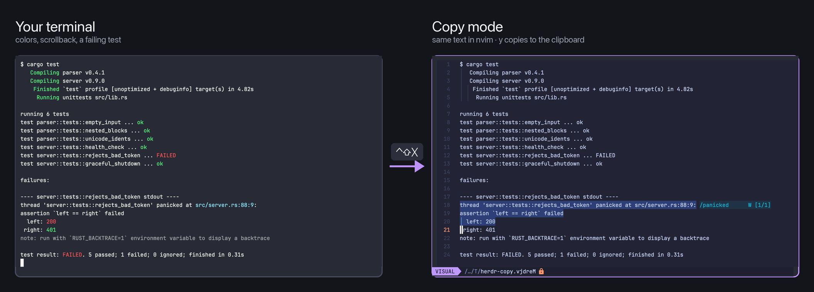

# tmux / WezTerm-style Copy Mode

Press `ctrl-shift-x` in any terminal and its screen and scrollback open read-only in nvim, in a new tab named "copy mode". Move and search with vim keys, select with `v`/`V`, and every yank lands on the system clipboard. `q` closes the tab and returns you to the tab you came from.

Herdr has no keyboard copy mode: its only way to copy is selecting text with the mouse. This mod was made to bring back the copy mode of tmux (`prefix [`) and WezTerm (`ctrl-shift-x`), where you select and copy terminal output without leaving the keyboard.

## What you see

- A new tab, named **copy mode**, placed right after the current tab. It holds one terminal running nvim.
- nvim shows the source terminal's text: plain text, no colors. It opens read-only, with the cursor on the last line.
- The rest of the window doesn't change. The mod itself opens a 1×1 overlay and closes it immediately, so you never see it.

## How it behaves

- `ctrl-shift-x` (global) works on the focused terminal, including the focused pane when a tab is split.
- In nvim, every vim motion, `/` search and visual mode works as usual. Any yank (`y`, `yy`, `yiw`, …) is also written to the system clipboard via OSC 52.
- `q` quits nvim. The copy mode tab then closes and the original tab is shown again.
- The copy is a snapshot taken at the moment you press the key; it doesn't follow new output.

## Built from

- `mods/copy-mode/mod.json`: `{"place":"none","overlay":{"width":1,"height":1}}`, so the mod is never docked and only opens as an overlay.
- `keys.json`: `"ctrl-shift-x": "mod.open:copy-mode"`.
- `mods/copy-mode/main.js`: in `init`, if `props().overlay` exists, it calls `closeOverlay`, reads `focused()` (`terminal`, `tab`) and runs `terminal.open` with `name: "copy mode"` and argv `["sh", "-c", 'exec "${HERDR_APP_HOME:-$HOME/.config/herdr-app}/mods/copy-mode/copy-mode.sh" "$@"', "copy-mode", terminal, tab]`. `render` returns an empty `div()`.
- `mods/copy-mode/copy-mode.sh`:
  1. writes `hc read <terminal>` (or `herdr-core read`) to a temp file;
  2. opens it with `nvim -R -S copy-mode.vim`;
  3. after nvim exits, it deletes the temp file and starts a detached `nohup` job that runs `terminal.kill` on its own terminal (`$HC_TERMINAL_ID`) and then `tab.select` on the original tab.
- `mods/copy-mode/copy-mode.vim`: maps `q` to `:qa!`, jumps to the end (`normal! G`), and adds a buffer-local `TextYankPost` autocmd. The autocmd pipes the yanked text through `base64` and writes `ESC ] 52 ; c ; <base64> BEL` to `/dev/tty`.
- Programs it runs: `sh`, `hc`/`herdr-core`, `nvim`, `base64`, `tr`, `herdr-app`. It reads no files outside its own folder and the temp file, and it never touches the network.

## Watch out

- A key action's `name:value` passes the value as a string. `terminal.open:["…"]` does not become argv, and the key just opens a plain shell tab. That is why the key opens a mod, and the mod calls `run("terminal.open", {argv})`.
- `home()` returned the user's home directory (`/Users/<you>`), not `~/.config/herdr-app`. So the script path is resolved by the shell from `HERDR_APP_HOME`, falling back to `~/.config/herdr-app`.
- Without the `props().overlay` guard, `herdr-app check` would run `init` and actually open a tab.
- herdr keeps the interactive shell open after an argv program exits, so the tab has to be closed explicitly. The order matters too: running `tab.select` before closing the tab sends focus to the neighbouring tab. That is why the script kills its own terminal first and selects the original tab afterwards, from a detached job that survives the kill.
- `hc read` returns the screen plus history. Full-screen programs such as agent TUIs and editors redraw in place, so you mostly get what is currently visible.
- Requires `nvim` and `hc` or `herdr-core` on `PATH`. The clipboard relies on herdr's OSC 52 support; it stops working if `clipboard_write` is `false` in settings.json. The OSC 52 limit is 1 MiB.
- If the mod folder is renamed (for example, to avoid a name clash), update the path in `main.js` and the action in `keys.json`.

## Done when

- `herdr-app check mods/copy-mode` passes.
- Pressing `ctrl-shift-x` in a shell that printed some output opens a tab named "copy mode" showing that output in nvim, with the cursor on the last line.
- `yy` on a line, then `pbpaste` (or pasting anywhere), gives that exact line.
- `q` closes the copy mode tab and shows the tab you started from, with no leftover shell tab.
- With a split tab, the focused pane's text is the one shown.
